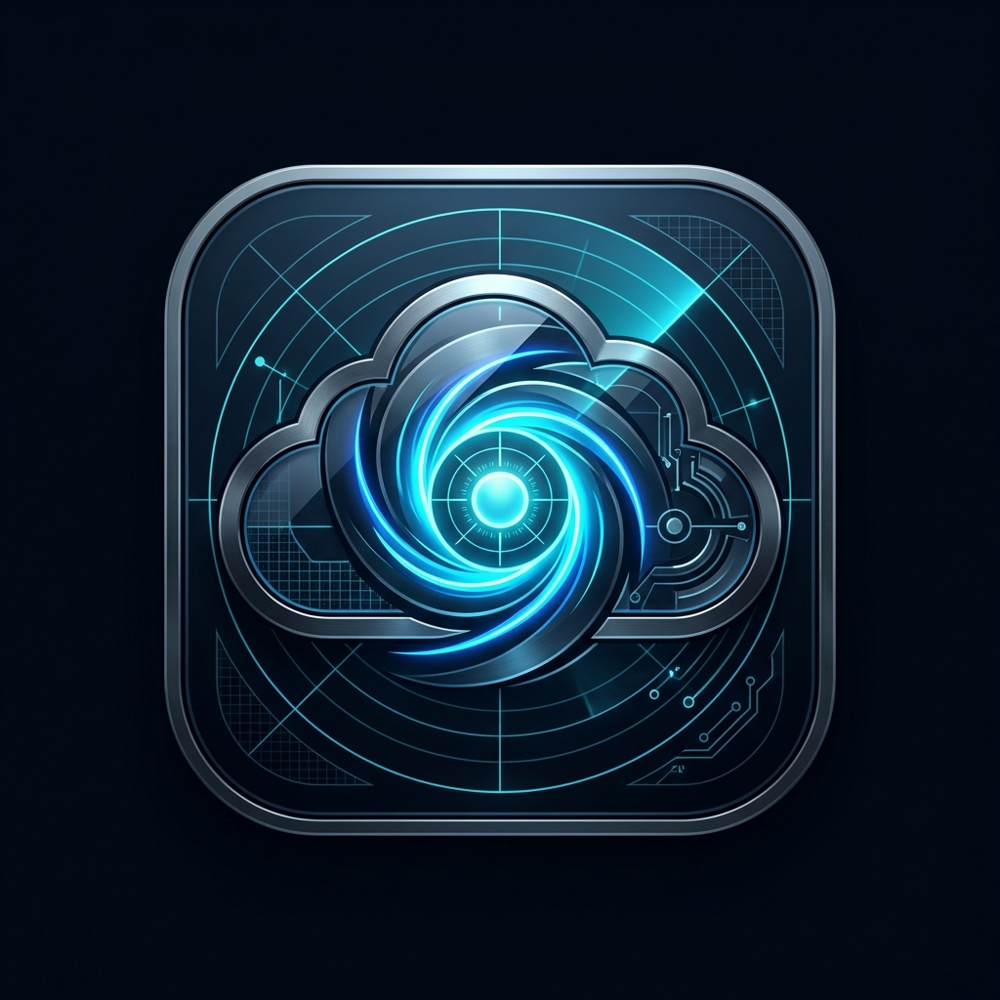

<div align="center">

  

  # ⚡ SKYFORGE
  ### **High-Fidelity Spatial Meteorological & Atmospheric Telemetry Platform**

  [](https://tyagigolu02.github.io/SkyForge_UI/)
  [](#progressive-web-app-pwa)
  [](#tech-stack)
  [](#tech-stack)
  [](#database--compute-optimization)

  <p align="center">
    An enterprise-grade weather intelligence dashboard engineered with an <b>Abyssal Glass</b> UI, real-time atmospheric telemetry, interactive hourly analytics, and full Progressive Web App (PWA) support.
  </p>

</div>

---

## 🚀 Overview

**SkyForge** goes beyond standard temperature forecasts by delivering deep atmospheric telemetry, astronomical cycles, air quality diagnostics, and hazard alerts in a unified spatial interface. Built on a decoupled **Spring Boot + React/TypeScript** architecture, it is installable as a native desktop and mobile application directly from your browser.

---

## ✨ Key Capabilities

* **🌐 Deep Atmospheric Telemetry:** Real-time tracking of Temperature, "Feels Like" thermal index, Barometric Pressure ($\text{hPa}$), Humidity, Visibility, Dew Point, and Cloud Cover.
* **🌬️ Air Quality & UV Diagnostics:** Comprehensive AQI breakdown ($\text{PM}_{2.5}$, $\text{PM}_{10}$, $\text{CO}$, $\text{NO}_2$, $\text{O}_3$, $\text{SO}_2$) paired with UV radiation exposure indexing.
* **📈 Multi-Day & Hourly Analytics:** Interactive 24-hour thermal/precipitation charts alongside extended multi-day forecasting and historical weather snapshots.
* **🌔 Astronomical & Wind Vectors:** Live Moon Phase illumination telemetry, Sunrise/Sunset windows, Wind Speed/Gusts ($\text{km/h}$), and directional compass vectors.
* **⚠️ Severe Weather & Hazard Alerts:** Automated meteorological warnings and localized environmental news dispatches.
* **📱 Progressive Web App (PWA):** Offline service-worker caching, auto-updating builds, and native fullscreen installation on Android, iOS, Windows, and macOS.

---

## 🛠️ Tech Stack

### **Frontend (`SkyForge_UI`)**
* **Framework:** React 18 + TypeScript + Vite
* **Styling:** Tailwind CSS (Custom *Abyssal Glass* dark theme)
* **PWA Engine:** `vite-plugin-pwa` with Workbox Auto-Update Service Worker
* **Hosting:** GitHub Pages (`/SkyForge_UI/`)

### **Backend (`SkyForge_API`)**
* **Framework:** Java 17+ / Spring Boot 3
* **Data Integration:** WeatherAPI Real-Time, Forecast, History & Astronomy Pipelines
* **Database:** Neon Serverless PostgreSQL with Spring Data JPA / Hibernate
* **Connection Pooling:** Optimized HikariCP (`scale-to-zero` compatible)

---

## 🏗️ System Architecture

```text
┌─────────────────────────┐         REST / JSON         ┌──────────────────────────┐
│   SkyForge PWA Client   │ ◄─────────────────────────► │   Spring Boot Backend    │
│  (React + Vite + SW)    │                             │  (WeatherService & DTOs) │
└─────────────────────────┘                             └────────────┬─────────────┘
                                                                     │
                                            ┌────────────────────────┴────────────────────────┐
                                            ▼                                                 ▼
                             ┌──────────────────────────────┐                  ┌──────────────────────────────┐
                             │       WeatherAPI Engine      │                  │   Neon Serverless Postgres   │
                             │ (Live, Forecast, AQI, Astro) │                  │  (HikariCP Zero-Idle Pool)   │
                             └──────────────────────────────┘                  └──────────────────────────────┘
```

---

## 📱 Progressive Web App (PWA)

SkyForge is fully installable as a standalone native app without browser chrome:
1. Open **[SkyForge Live](https://tyagigolu02.github.io/SkyForge_UI/)** in Google Chrome, Edge, or Safari.
2. **Desktop:** Click the **Install SkyForge** icon in the right side of the URL address bar.
3. **Mobile (Android/iOS):** Tap **Browser Menu (`⋮` / Share)** $\rightarrow$ **"Install App"** or **"Add to Home Screen"**.

---

## ⚡ Local Setup & Deployment

### **1. Clone the Repository**
```bash
git clone https://github.com/tyagigolu02/SkyForge_UI.git
cd SkyForge_UI
```

### **2. Install Dependencies**
```bash
npm install
```

### **3. Run Development Server**
```bash
npm run dev
```

### **4. Build & Deploy to GitHub Pages**
```bash
npm run deploy
```

---

## 🗄️ Database & Compute Optimization

To ensure zero data loss while respecting serverless PostgreSQL compute quotas, the backend utilizes an optimized **HikariCP** lifecycle (`minimum-idle=0`, `idle-timeout=30000`, `connection-timeout=30000`), allowing the database compute node to safely auto-suspend during inactivity and wake seamlessly on incoming requests.

---

<div align="center">
  <sub>Engineered with precision by <b>Deepanshu Tyagi</b> • Powered by SkyForge Telemetry</sub>
</div>
